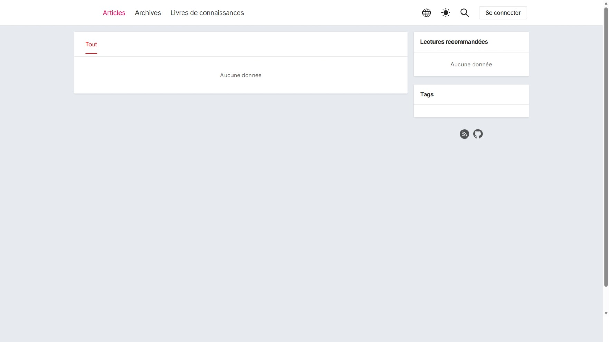
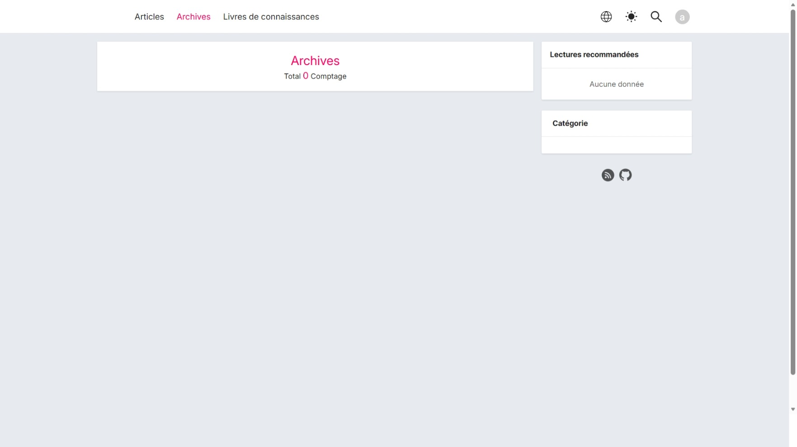
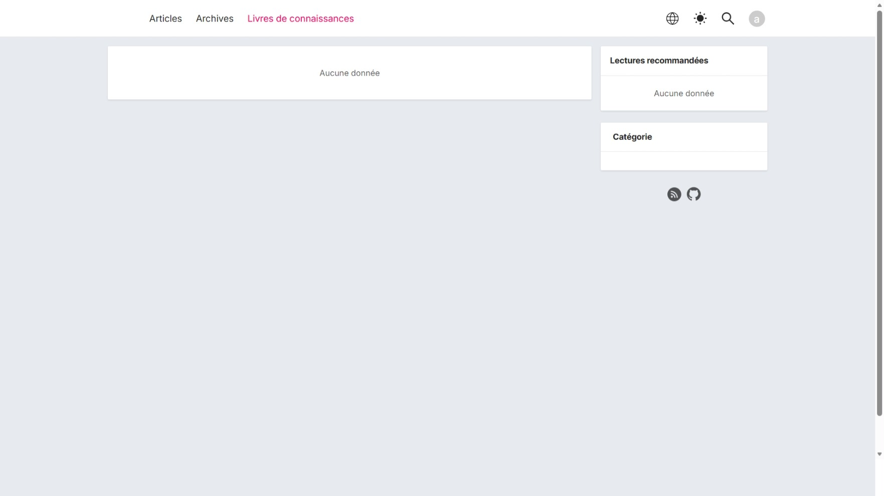
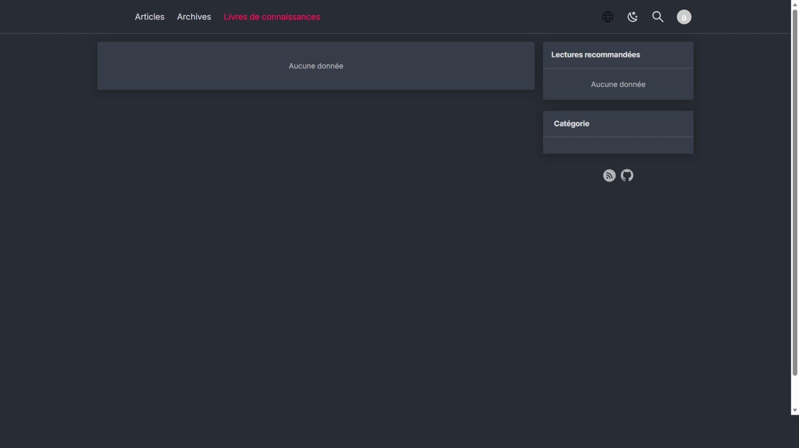
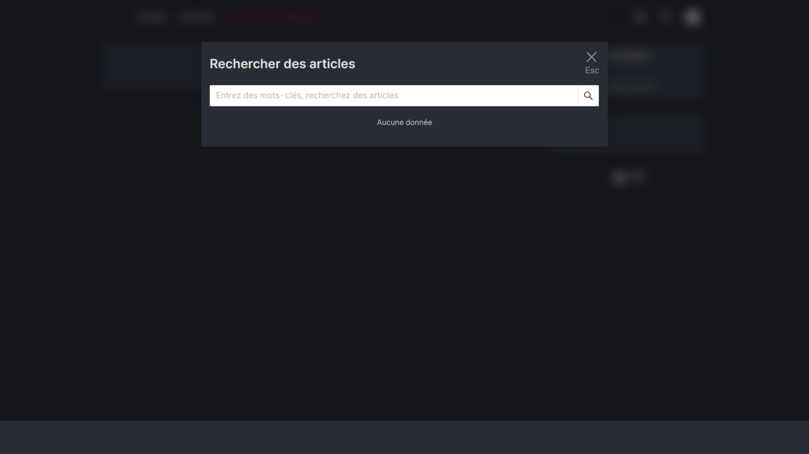
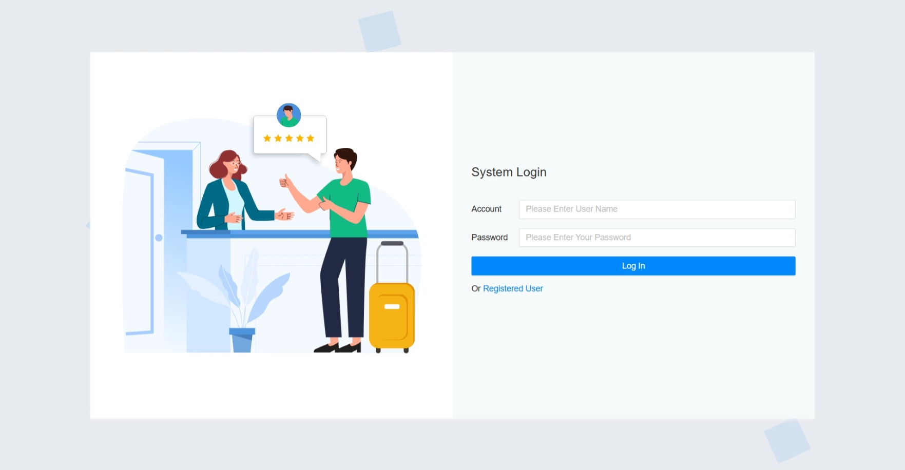
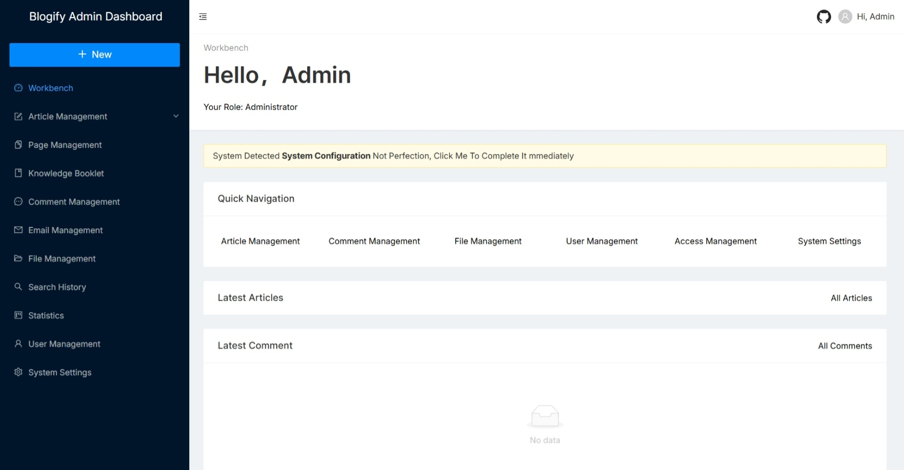

# Blogify

## Introduction

Blogify Is An Open Source CMS System For Individuals That Integrates Article Publishing, Page Creation, Knowledge Booklets And Other Functions. The Technologies Involved Are As Follows:

- `MySQL`: Data Storage
- `Next.js`: Front-End Page Framework
- `Nest.js`: Server-Side Framework
- `AliyunOSS`: Object Storage

## Link

- [Github source code](https://github.com/seifeslimene/blogify)
- [Front page](https://blog.seifeslimene.com/)
- [Management System](https://admin.blog.seifeslimene.com/): Supports guest registration

## Function Points

- Article Management
- Page Management
- Email Management
- Comment Management
- File Management
- Statistics
- System Settings
- Knowledge Booklet

For More Functions, Welcome To Visit The System To Experience It.

## Preview









## Project Running

### Database

First Install `MySQL`, It Is Recommended To Use Docker For Installation.

```bash
docker image pull mysql:5.7
docker run -d --restart=always --name blogify -p 3306:3306 -e MYSQL_ROOT_PASSWORD=root mysql:5.7
```

Then Create The Database In `MySQL`.

```bash
docker container exec -it blogify bash;
mysql -u root -p;
CREATE DATABASE `blogify` DEFAULT CHARACTER SET utf8mb4 COLLATE utf8mb4_unicode_ci;
```

### Run Locally

First, Clone The Project.

```bash
git clone --depth=1 https://github.com/seifeslimene/blogify.git your-project-name
```

Then, Install The Project Dependencies.

```bash
# Install pnpm globally
npm i -g pnpm

pnpm install
```

- Startup The Project

```bash
pnpm run dev
```

Front Page Address: `http://localhost:3001`.
Backend Management Address: `http://localhost:3002`.
Service Interface Address: `http://localhost:3003`.

When Started For The First Time, The Administrator User Is Created By Default: admin, Password: admin (Can Be Modified In The `.env` File).
[PS] If The Server Configuration Fails To Start, Please First Confirm Whether The MySQL Configuration Is Correct. The Configuration File Is In `.env`.

### System Setting

When The Project Is First Started, System Settings Need To Be Performed In The Background. As The Content Becomes Richer, The Page Content Will Also Become Richer.

### Configuration File

The `.env` File Is Loaded By Default, And The Production Environment Will Try To Load The `.env.prod` File.

```bash
# Client Running Port
CLIENT_PORT=3001
# Client Site Address (Assuming It Is Deployed To https://xx.com, Set CLIENT_SITE_URL To https://xx.com)
CLIENT_SITE_URL=http://localhost:3001
# Client Resource Address (Assuming It Is Deployed To https://xx.com, Set CLIENT_ASSET_PREFIX To https://xx.com, If The Resource Is Uploaded To CDN, Change It To The CDN Address)
CLIENT_ASSET_PREFIX=/

# Manage Background Running Port
ADMIN_PORT=3002
# Management Background Resource Address (Assuming It Is Deployed To https://xx.com, Set CLIENT_ASSET_PREFIX To https://xx.com, If The Resource Is Uploaded To CDN, Then Change It To The CDN Address)
ADMIN_ASSET_PREFIX=/

# Server Running Port
SERVER_PORT=3003
# Complete Access Path To The Server
SERVER_API_URL=http://localhost:3003/api
# Server Interface Prefix (Assuming You Want To Access Through http://xx:com/api, Then Set It To /api; If http://xx:com, Then Set It To /)
SERVER_API_PREFIX=/api
# Default Administrator Account Name
ADMIN_USER=admin
# Default Administrator Account Password
ADMIN_PASSWD=admin
# The Following Is The Database Configuration, Please Create The Table First
DB_HOST=127.0.0.1
DB_PORT=3306
DB_USER=root
DB_PASSWD=root
DB_DATABASE=blogify

# Github Third-Party Login Configuration
GITHUB_CLIENT_ID="" # Github OAuth Login ID
GITHUB_CLIENT_SECRET="" # Github OAuth Login Secret
```

### Project Deployment

The Script Deployed In The Production Environment Is As Follows:

```bash
node -v
npm -v
npm config set registry http://registry.npmjs.org
npm i -g pm2 @nestjs/cli pnpm
pnpm install
pnpm run build
pnpm run pm2
pm2 startup
pm2 save
```

### Nginx Configuration

Use A Reverse Proxy To Configure `nginx`, And Set `proxy_set_header X-Real-IP $remote_addr;` At The Same Time So That The Server Can Obtain The Real IP Address.

```bash
upstream blogify_client {
   server 127.0.0.1:3000;
   keepalive 64;
}

# HTTP -> HTTPS Redirect
server {
   listen 80;
   server_name domain name;
   rewrite ^(.*)$ https://$host$1 permanent;
}

server {
   listen 443 ssl;
   server_name domain name;
   ssl_certificate certificate storage path;
   ssl_certificate_key certificate storage path;

   location/{
     proxy_http_version 1.1;
     proxy_set_header Upgrade $http_upgrade;
     proxy_set_header Connection "upgrade";
     proxy_set_header Host $host;
     proxy_set_header X-Nginx-Proxy true;
     proxy_cache_bypass $http_upgrade;
     proxy_pass http://blogify_client; #Reverse proxy
     proxy_set_header X-Real-IP $remote_addr;
     proxy_set_header X-Forwarded-For $proxy_add_x_forwarded_for;
   }
}
```

## Material

- Next.js Source Code: <https://github.com/vercel/next.js>
- Next.js Documentation: <https://nextjs.org/>
- Nest.js Source Code: <https://github.com/nestjs/nest>
- Nest.js Documentation: <https://nestjs.com/>
